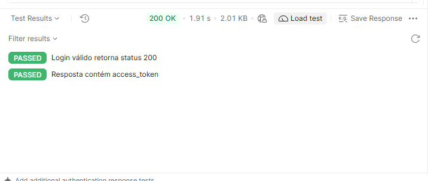
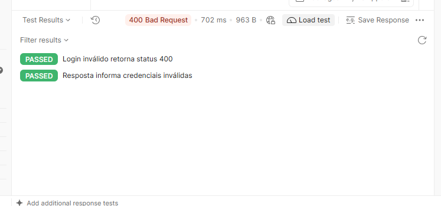
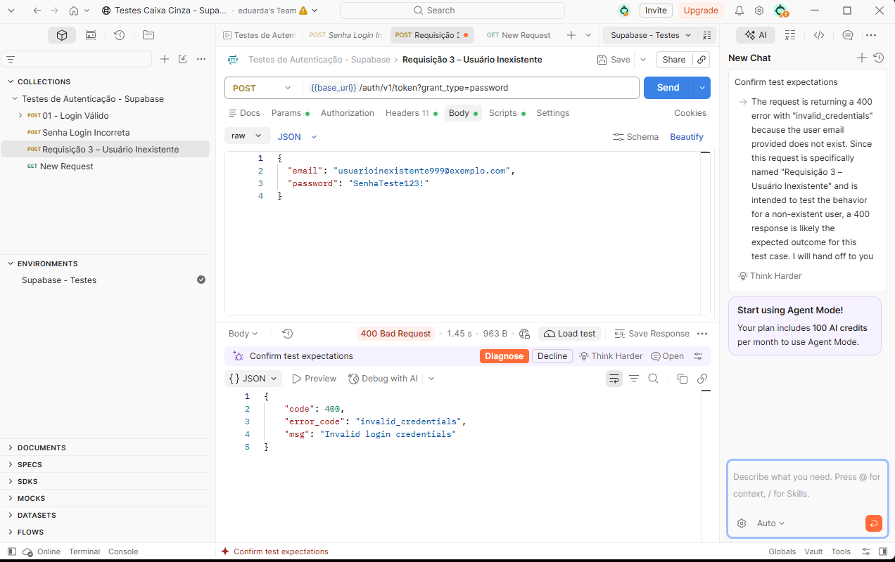
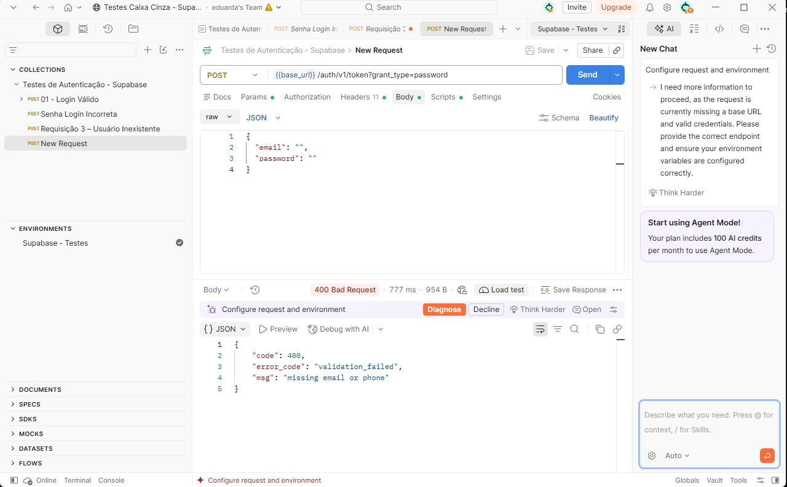
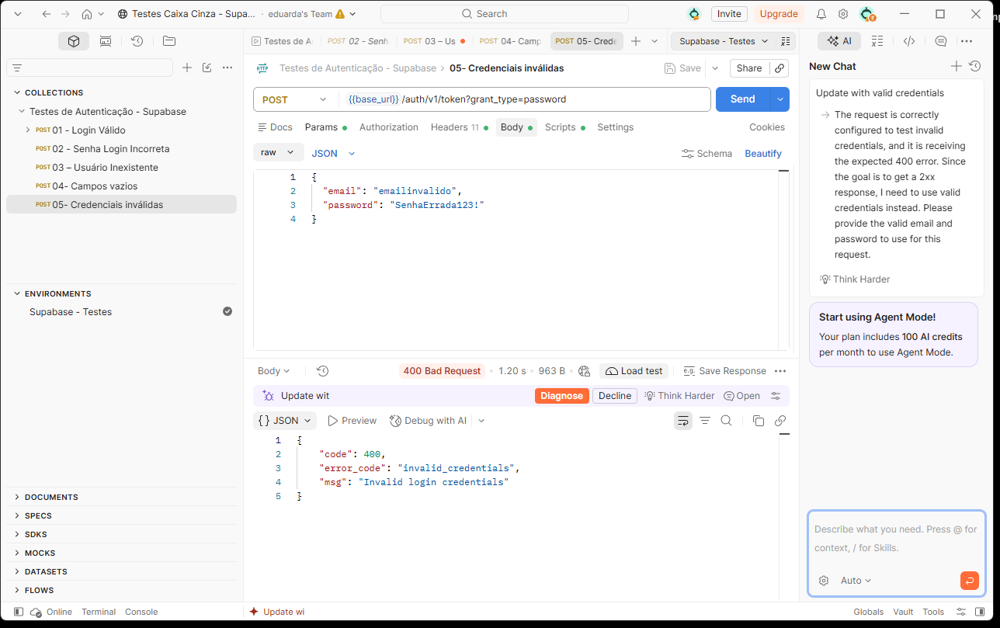

# Teste Caixa Cinza com Supabase e Postman

**Atividade acadêmica — UX/UI e Testes de Software**  
**Projeto:** FoodExpress — testes da API de autenticação  
**Ferramentas:** Supabase, Postman Desktop, Git e GitHub

## Introdução

Este repositório documenta a execução de testes funcionais de **caixa cinza** na API de autenticação do Supabase. A técnica de caixa cinza combina o conhecimento parcial da implementação — como endpoint, método HTTP, cabeçalhos e formato JSON — com a verificação do comportamento observado nas respostas da API.

Os testes foram realizados no **Postman Desktop**, sem necessidade de desenvolver uma interface gráfica para a atividade. O Supabase foi utilizado para disponibilizar o serviço de autenticação por e-mail e senha.

## Objetivo da Atividade

Configurar um ambiente de autenticação no Supabase, cadastrar um usuário de teste, construir requisições HTTP no Postman, executar cenários positivos e negativos de login e registrar as evidências e os resultados obtidos.

Foram avaliados cinco cenários: login válido, senha incorreta, usuário inexistente, campos vazios e credenciais inválidas.

## Configuração do Supabase

Foi criado e configurado um projeto no Supabase para disponibilizar a autenticação de usuários. No painel **Authentication**, foi habilitado o provedor de autenticação por **e-mail**, e um usuário de teste foi cadastrado para a execução das requisições. Também foram identificados a **URL do projeto** e a **chave pública de API** necessária para o acesso ao serviço.

O Supabase gerencia a validação das credenciais e retorna respostas HTTP com dados JSON, incluindo um token de acesso quando o login é autorizado.


## Configuração do Postman

Foi utilizado o Postman Desktop para organizar e executar os testes de autenticação. A coleção criada recebeu o nome **`Testes de Autenticação - Supabase`**, com cinco requisições correspondentes aos cenários avaliados. O ambiente **`Supabase - Testes`** foi configurado para reutilizar as variáveis nas requisições.

| Variável | Finalidade |
|---|---|
| `base_url` | URL base do projeto Supabase |
| `api_key` | Chave pública (`anon` ou `publishable`) utilizada na API |
| `email` | E-mail do usuário de teste |
| `password` | Senha do usuário de teste |


## Configuração das Requisições

O endpoint de autenticação foi acessado por uma requisição **POST**:

```http
POST {{base_url}}/auth/v1/token?grant_type=password
```

Os cabeçalhos utilizados foram:

| Header | Valor |
|---|---|
| `apikey` | `{{api_key}}` |
| `Authorization` | `Bearer {{api_key}}` |
| `Content-Type` | `application/json` |

O corpo da requisição foi enviado no formato **raw / JSON**:

```json
{
  "email": "{{email}}",
  "password": "{{password}}"
}
```

Nos testes negativos, os valores do corpo foram alterados de acordo com o cenário, mantendo o mesmo endpoint de autenticação. As respostas foram avaliadas por meio do código HTTP e do conteúdo JSON.

## Execução dos Testes

As cinco requisições foram executadas no Postman e comparadas com o comportamento esperado.

### CT-01 — Login válido

- **Entrada:** e-mail e senha válidos de um usuário cadastrado.
- **Esperado:** HTTP `200` e retorno de `access_token`.
- **Obtido:** HTTP `200`, com token de acesso na resposta.
- **Status:** **Aprovado**.



### CT-02 — Senha incorreta

- **Entrada:** e-mail cadastrado e senha incorreta.
- **Esperado:** acesso negado com resposta de erro de autenticação.
- **Obtido:** HTTP `400`, código `invalid_credentials` e mensagem `Invalid login credentials`.
- **Status:** **Aprovado**.



### CT-03 — Usuário inexistente

- **Entrada:** e-mail não cadastrado e senha informada.
- **Esperado:** acesso negado.
- **Obtido:** HTTP `400`, código `invalid_credentials` e mensagem `Invalid login credentials`.
- **Status:** **Aprovado**.



### CT-04 — Campos vazios

- **Entrada:** e-mail e senha vazios.
- **Esperado:** erro de validação dos campos obrigatórios.
- **Obtido:** HTTP `400`, código `validation_failed` e mensagem `missing email or phone`.
- **Status:** **Aprovado**.



### CT-05 — Credenciais inválidas

- **Entrada:** e-mail em formato inválido (`emailinvalido`) e senha incorreta.
- **Esperado:** falha de autenticação e mensagem de erro.
- **Obtido:** HTTP `400`, código `invalid_credentials` e mensagem `Invalid login credentials`.
- **Status:** **Aprovado**.



## Registro dos Testes

Os cenários foram documentados em uma planilha de testes, com os campos **ID**, **cenário**, **entrada**, **resultado esperado**, **resultado obtido**, **status** e **observações**. Esse registro permite comparar o comportamento previsto com o observado e manter a rastreabilidade dos testes.


## Resultados Obtidos

| ID | Cenário | HTTP obtido | Resultado | Status |
|---|---|---:|---|---|
| CT-01 | Login válido | 200 | Autenticação e token retornados | Aprovado |
| CT-02 | Senha incorreta | 400 | `invalid_credentials` | Aprovado |
| CT-03 | Usuário inexistente | 400 | `invalid_credentials` | Aprovado |
| CT-04 | Campos vazios | 400 | `validation_failed` | Aprovado |
| CT-05 | Credenciais inválidas | 400 | `invalid_credentials` | Aprovado |

**Total: 5 cenários executados, 5 comportamentos esperados observados e nenhuma divergência identificada nesses cenários.**

Os códigos HTTP `400` dos testes negativos **não representam falhas da execução**: nesses casos, a rejeição das entradas inválidas era precisamente o resultado esperado.

## Conclusão

A atividade permitiu configurar um serviço de autenticação com Supabase e validar seu funcionamento diretamente por meio de requisições HTTP no Postman. O cenário positivo confirmou a emissão de um token para credenciais válidas, enquanto os cenários negativos demonstraram a rejeição de senhas incorretas, usuários inexistentes, campos vazios e credenciais inválidas.

Uma dificuldade importante durante a configuração foi garantir o uso correto das variáveis de ambiente e da URL base, pois referências não resolvidas impedem o envio das requisições. Após o ajuste do ambiente, os cinco cenários puderam ser executados e documentados.

Como melhoria futura, os testes podem ser automatizados com verificações adicionais sobre a estrutura das respostas JSON e executados em conjunto no Collection Runner. Os resultados demonstram a importância dos testes de caixa cinza para verificar o comportamento de APIs de autenticação e registrar evidências de maneira reproduzível.

---

### Estrutura de entrega

```text
/
├── README.md
├── postman/
│   ├── [coleção exportada].json
│   └── [ambiente exportado].json
├── prints/
│   ├── 01-login-valido-resultado.png
│   ├── 02-senha-incorreta-resultado.png
│   ├── 03-usuario-inexistente.png
│   ├── 04-campos-vazios.png
│   ├── 05-credenciais-invalidas.png
│   └── 06-planilha-registros.png
└── planilha/
    └── [planilha de testes]
```


